  

## Hi, I'm Andkull 👋

I build blockchain systems and the web apps around them — from Proof-of-Work ledgers and Solidity smart contracts to the TypeScript backends and frontends that make them usable. I like test-driven development, tamper-evident data, and interfaces that turn contract reverts into messages people can actually read.

## 🛠️ Tech

## 📦 Projects

| Repository | What it does | Stack |
| :--- | :--- | :--- |
| [**Aletheia**](https://github.com/Andkull/Aletheia) | Access logging for medical records. Patient data stays in SQL, and every read or write becomes a signed event on a blockchain shared by peer nodes, so patients can see who opened their journal and nobody can quietly rewrite the log. Role-based access for doctors, nurses, clinics and patients. *(fork of [0pStack/Aletheia](https://github.com/0pStack/Aletheia))* | TypeScript · React · Express · SQLite · three.js |
| [**ScoreSystem**](https://github.com/Andkull/ScoreSystem) | An on-chain daily guessing game. Players register, guess a number once every 24 hours to earn points, transfer points to other members and redeem 50 points for a T-shirt. Includes an admin panel and readable revert/wallet errors in the UI. | Solidity · Foundry · React · viem · MetaMask |
| [**luxurious-products**](https://github.com/Andkull/luxurious-products) | Anti-counterfeiting REST API for luxury goods. Each product gets a digital passport, ownership transfers are mined into a Proof-of-Work chain persisted in SQLite, and `/api/verify/:serial` returns the current owner, full history and whether the chain is still valid. | TypeScript · Express · better-sqlite3 · Vitest |
| [**coffee-blockchain**](https://github.com/Andkull/coffee-blockchain) | A Proof-of-Work ledger tracking Fair Trade coffee batches between growers, roasters and cafés. Express endpoints to submit validated batch transactions, mine pending ones into SHA-256 blocks and read the chain — built red-to-green with TDD. | TypeScript · Express · Vitest · Supertest |
| [**ethereum-dashboard**](https://github.com/Andkull/ethereum-dashboard) | A Sepolia dashboard: check account balances, browse the latest blocks, inspect transaction details and send ETH through MetaMask. | TypeScript · viem · Vite · HTML/CSS |
| [**Westcoast-Education-Platform**](https://github.com/Andkull/Westcoast-Education-Platform) | Course platform for a fictional education company. Students browse courses, register, log in and book a course; admins add new courses through a validated form and see all bookings. Backed by json-server. | TypeScript · JavaScript · HTML/CSS · json-server · Vitest |

## 📊 GitHub Stats

  
  

